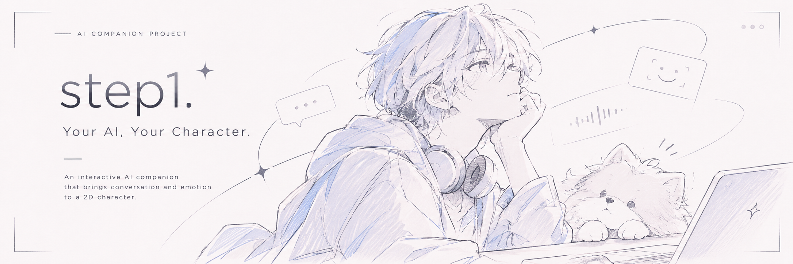
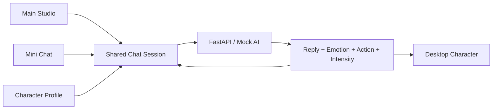
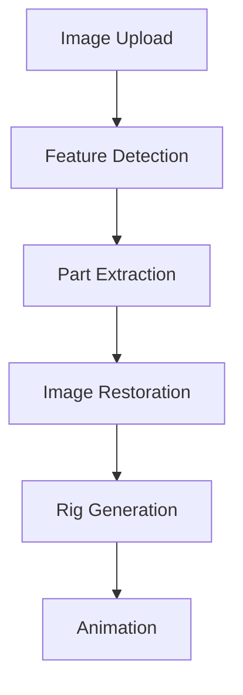

<div align="center">



<br/>

**A little closer to being alive.**

대화하고, 감정을 표현하고, 일상을 함께하는 AI.

<br/>


</div>

<br/>

## 01 — About

**Step1** is an interactive AI desktop companion.

텍스트로 존재하는 AI에게 형체와 개성을 부여하고,
대화와 감정을 캐릭터의 표정과 움직임으로 표현합니다.

내가 만든 캐릭터에게 이름과 성격을 부여하고,
바탕화면에서 함께 일하고 대화하는 작은 동반자를 만들어갑니다.

> 현재는 규칙 기반 Mock AI를 사용하여 비용 없이 캐릭터와 감정 시스템을 테스트할 수 있습니다. 실제 언어 모델 연동은 다음 개발 단계입니다.

<br/>

## 02 — Features

| Feature | Description |
| :--- | :--- |
| Conversation | 메인 스튜디오와 독립형 미니 채팅창의 대화 기록 공유 (실행 세션 내) |
| Personality | 네 가지 캐릭터별 이름, 성격 및 말투 설정 · 저장 및 재실행 복원 |
| Emotion System | 기본, 기쁨, 신남, 슬픔, 부끄러움, 화남, 당황, 졸림, 놀람, 장난기, 애정 |
| Animation | 눈 깜빡임, 입 움직임, 표정, 감정별 움직임 및 차분한 생각하기 모션 |
| Desktop Companion | 투명한 바탕화면 캐릭터, 클릭·드래그, 50–200% 크기 조절 |
| Mini Chat | 캐릭터와 함께 이동하거나 자유롭게 분리해서 이동 · 위치 기억 |
| Auto Rigging | 업로드한 이미지의 얼굴 파츠를 검출하고 움직이는 캐릭터 생성 |
| Companion Studio | 캐릭터 미리보기, 프로필 편집, 11가지 감정 테스트 및 커스텀 제작 |

### Meet the companions

| 캐릭터 | 기본 프로필 | 표현 방식 |
| :--- | :--- | :--- |
| 모찌 · Basic | 다정한 친구 | 벡터 기반 눈, 입, 눈썹 및 표정 효과 |
| 루나 · Illustration | 차분한 친구 | 감정별 일러스트 이미지 |
| 포미 · Pomeranian | 장난꾸러기 | 분리된 눈·코·입·꼬리 파츠와 애니메이션 |
| 내 친구 · Custom | 사용자 설정 | 업로드 이미지에서 검출한 얼굴 파츠의 자동 리깅 |

각 캐릭터의 이름·성격·말투는 직접 변경할 수 있습니다.

<br/>

## 03 — How it works



### Automatic Character Rigging

정적인 이미지에 움직임을 부여합니다.



<br/>

## 04 — Getting Started

macOS 기준입니다. Python 3.13과 Node.js가 필요합니다. 아래 예시는 저장소를 `~/Desktop/Step1`에 내려받은 경우이며, 다른 위치에 저장했다면 해당 경로로 변경해 주세요.

### 1. Backend

```bash
cd ~/Desktop/Step1/backend
python3.13 -m venv ~/.venvs/step1
source ~/.venvs/step1/bin/activate
python -m pip install fastapi "uvicorn[standard]" python-multipart pillow numpy opencv-python-headless openai python-dotenv
uvicorn main:app --reload --reload-dir app
```

서버 상태: [http://127.0.0.1:8000/api/health](http://127.0.0.1:8000/api/health)

가상환경을 프로젝트 외부에 만드는 이유는 iCloud의 파일 최적화로 Python 라이브러리 로딩이 지연되는 문제를 방지하기 위함입니다.
가상환경 생성과 라이브러리 설치는 최초 한 번만 하면 됩니다.

### 2. Frontend

별도의 터미널에서 실행합니다.

```bash
cd ~/Desktop/Step1/frontend
npm ci
npm run dev
```

웹 미리보기: [http://localhost:5173](http://localhost:5173)

### 3. Desktop App

프론트엔드 개발 서버가 실행 중인 상태에서 또 다른 터미널을 열고 실행합니다.

```bash
cd ~/Desktop/Step1/frontend
npm run electron
```

캐릭터를 클릭하면 미니 채팅이 열립니다. 헤더를 드래그하면 채팅창을 독립적으로 움직일 수 있고, 연결 버튼으로 다시 캐릭터 옆에 붙일 수 있습니다.

### Tests

```bash
cd ~/Desktop/Step1/frontend
npm test
npm run build

cd ~/Desktop/Step1/backend
source ~/.venvs/step1/bin/activate
python -m unittest discover -s tests -v
```

<br/>

## 05 — Development

| Module | Status |
| :--- | :--- |
| STEP 15–16 · Desktop Scaling & Hit Testing | Implemented |
| STEP 17 · Independent Mini Chat | Implemented |
| STEP 18 · Companion Studio UI | Implemented |
| STEP 19 · Character Personality | Implemented |
| STEP 19-2 · Extended Expressions (11 Emotions) | Implemented |
| STEP 20 · LLM Integration | Next |
| STEP 21 · Long-term Memory & Conversation History | Planned |
| STEP 22 · Proactive Interaction | Planned |
| STEP 23 · Voice Interaction | Planned |

[View Development Roadmap](./ROADMAP.md)

<br/>

> Automatic rigging is experimental and uses rule-based computer vision.
> 얼굴 파츠 검출 결과에 따라 커스텀 캐릭터의 표정 표현 품질이 달라질 수 있습니다.
> 장기 기억, 실제 LLM 및 음성 대화 기능은 아직 구현되지 않았습니다.

<br/>

---

<div align="center">

<sub>STEP1 — AI COMPANION PROJECT</sub>

<br/>

*Making AI feel more alive.*

</div>
