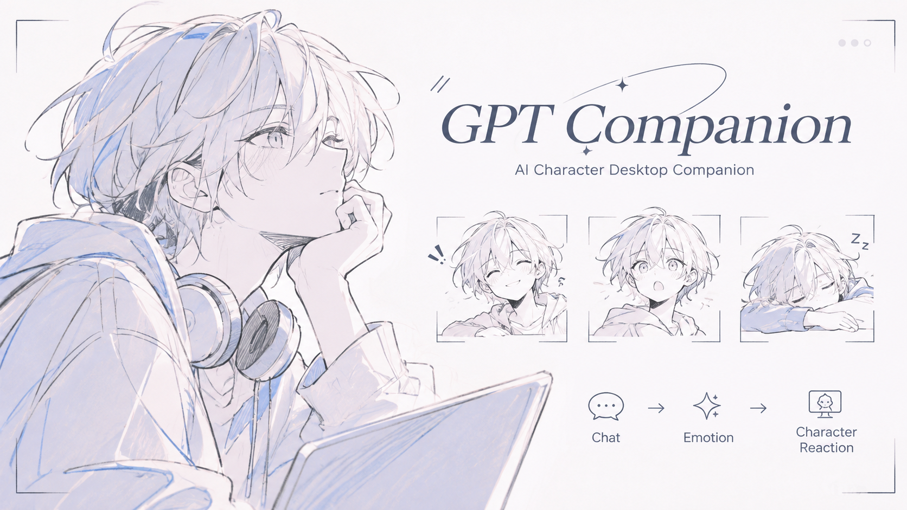

 

# GPT Companion

**Your AI, Your Character.**

AI의 대화와 감정을 2D 캐릭터의 표정과 움직임으로 표현하는  
인터랙티브 AI 컴패니언 프로젝트

 

---

### Overview

**GPT Companion**은 AI의 응답을 캐릭터의 감정과 움직임으로 시각화하는 프로젝트

캐릭터와 상호작용하는 새로운 AI 경험을 목표

### Features

- **AI Chat** — React · FastAPI 기반 채팅
- **Emotion Response** — AI 응답에 따른 감정 및 표정 변화
- **2D Animation** — 감정 강도에 따른 캐릭터 움직임
- **Manual Controls** — 표정 및 행동 수동 제어

## Development Roadmap

- [x] Chat UI & Backend
- [x] Mock AI Integration
- [x] Emotion-driven Animation
- [x] Character Selection
- [x] Pomeranian Character
  - [x] PNG Part-based Rendering
  - [x] Eye Blinking
  - [x] Emotion-based Facial Expressions
  - [x] Talking Animation
  - [x] Emotion-based Body Animation
  - [x] Smooth Expression Transitions
  - [x] Emotion-based Tail Animation
- [ ] LLM Integration
- [ ] Character Customization
- [ ] Voice Interaction
- [ ] Desktop Application (Electron)

---

Currently in Development

 

*Making AI feel more alive.*

