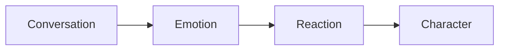
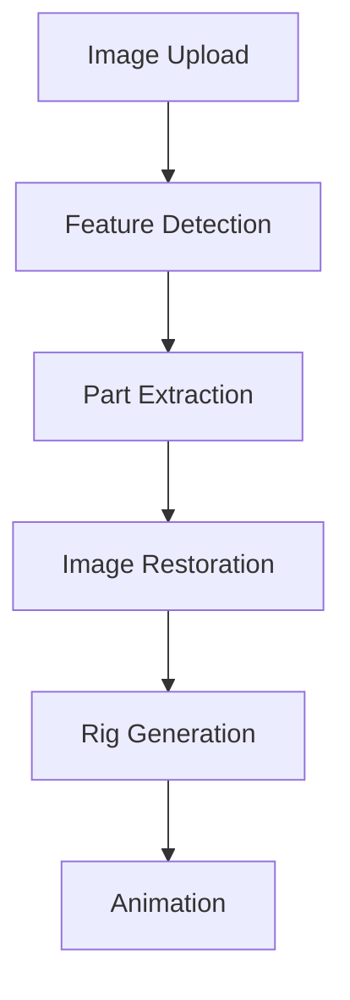

 

**A little closer to being alive.**

대화하고, 감정을 표현하고, 일상을 함께하는 AI.

 

 

## 01 — About

**Step1** is an interactive AI desktop companion.

텍스트로 존재하는 AI에게 형체를 부여하고,
대화와 감정을 캐릭터의 표정과 움직임으로 표현합니다.

사용자가 원하는 캐릭터와 일상을 공유하는
새로운 AI 인터랙션을 만들어갑니다.

 

## 02 — Features

| Feature | Description |
| :--- | :--- |
| Conversation | AI와의 실시간 텍스트 대화 |
| Emotion | 대화에 따른 감정 및 표정 변화 |
| Animation | 캐릭터의 움직임과 눈 깜빡임 |
| Desktop | 바탕화면에서 함께하는 AI 캐릭터 |
| Auto Rigging | 이미지 기반 자동 캐릭터 리깅 |
| Customization | 나만의 캐릭터 생성 · 개발 중 |

 

## 03 — How it works

### Automatic Character Rigging

정적인 이미지에 움직임을 부여합니다.

 

## 04 — Development

| Module | Status |
| :--- | :--- |
| Chat & Backend | Implemented |
| Emotion System | Implemented |
| Character Animation | Implemented |
| Desktop Companion | Implemented |
| Automatic Rigging | Prototype |
| Custom Character Integration | Planned |
| LLM Integration | Planned |
| Voice Interaction | Planned |

[View Development Roadmap](./ROADMAP.md)

 

> Currently using a Mock AI Provider.
> Automatic rigging is experimental and uses
> rule-based computer vision.

 

---

STEP1 — AI COMPANION PROJECT

 

*Making AI feel more alive.*

